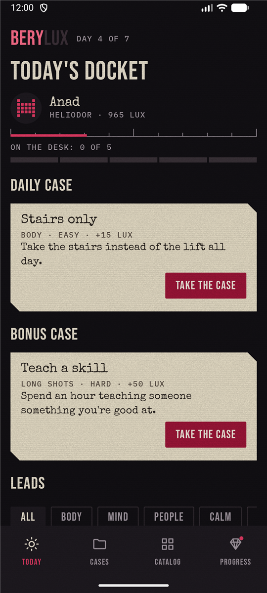
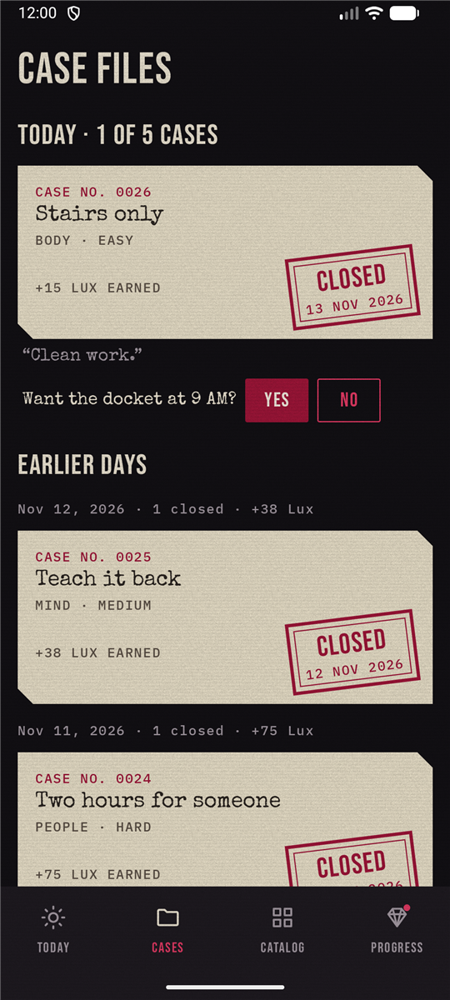
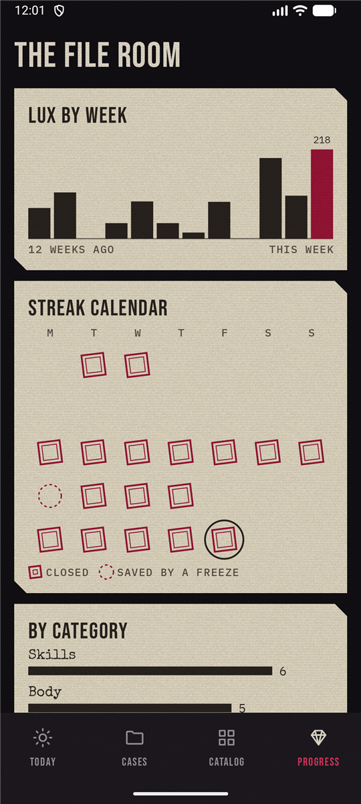
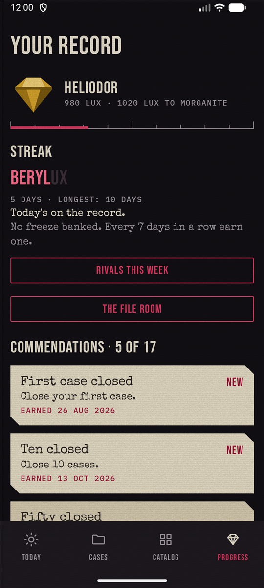
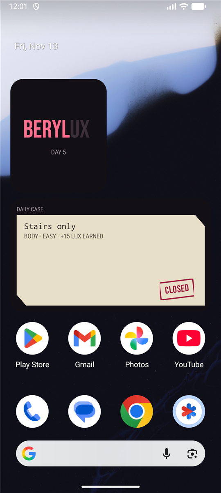
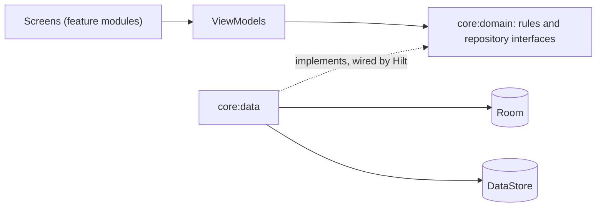

# Berylux

An Android app that hands you a few challenges every day and keeps score of the ones you close.

[](https://github.com/An3DCu/Berylux/actions/workflows/ci.yml)
[](LICENSE)


## Overview

Habit apps tend to be either a plain checklist or a pile of streak pressure. Berylux sits in between: every day it offers one daily case, one bonus case and four picks from categories like Body, Mind and People. You take on up to five, close the ones you finish, and earn Lux. Lux moves you up six gem ranks, from goshenite to red beryl.

It works fully offline. Signing in will be optional and syncs with my own server ([roadmap](#roadmap)).

This is a work in progress. Version 0.4 is the whole game, played offline as a guest, in its own look: a case file on a dark desk, with red beryl as the only accent. It now reaches past the app: a morning reminder, two home screen widgets and launcher shortcuts.

## Features in v0.4

- **Start:** pick a name and a generated sigil. No account.
- **Today:** the daily case, a bonus case and four picks, your rank and Lux, and how many of the day's 5 slots are used. The BERYLUX sign lights a letter for each day of your streak.
- **Cases:** close a case for its Lux, or drop it for 5 Lux. Both ask first. A closed case gets the CLOSED stamp and a line from the narrator. A case still open when the day ends goes cold. Earlier days are listed below today's.
- **Catalog:** 56 challenges in 7 categories, filtered by difficulty ([`challenges.json`](core/database/src/main/assets/seed/challenges.json)). Write your own in My cases, and change or delete them. Your own give no Lux, but they count for the streak.
- **Progress:** six gem ranks from goshenite to red beryl, each with its own gem, the streak with earned freezes, and 17 commendations that unlock as you play.
- **The file room:** from Progress, Lux by week for 12 weeks, a five-week streak calendar with a small CLOSED stamp on each day that counts, and closed cases by category. Drawn with Canvas.
- **Morning docket:** a reminder at 9 AM, or any time you pick, naming the day's daily case. It's off until you turn it on, in Cases after a close or in Settings.
- **Widgets:** the BERYLUX sign with your streak day, and today's daily case. Close on the daily case opens the app's own question.
- **Tablets and shortcuts:** a side rail and a 720dp reading width on wide screens. Long-press the icon for Case files, Today's docket and Write a case.
- **Rivals:** a weekly board against five bots, each with its own habit. They're marked as bots. Their Lux comes from a seed, and the board is the same on every launch.
- **Profile and Settings:** change your name and sigil. Pick the hour the day starts, the theme (dark desk or case paper), the grain and scanlines, and full or reduced motion.
- **Accessibility:** text up to 200%, TalkBack labels on every drawn piece, contrast of at least 4.5:1 in both themes, touch targets of at least 48dp.
- **Tests:** 291 tests on the JVM, screenshot tests of the drawn pieces, an instrumented test of the main flow, and CI on every pull request with the coverage of the rules.

## Screenshots

<p>
  
  
  
  
  
</p>

## Tech stack

| Layer | Tools |
|---|---|
| Language | Kotlin 2.4, Java 17 bytecode |
| UI | Jetpack Compose, Material 3 under my own design system |
| Graphics | Compose Canvas, AGSL shaders on Android 13 and newer |
| Device | WorkManager, Jetpack Glance widgets, launcher shortcuts |
| Architecture | MVVM, one-way data flow, 19 Gradle modules with convention plugins |
| Dependency injection | Hilt |
| Data | Room, DataStore |
| Navigation | Navigation 3 |
| Testing | JUnit 4, Truth, Turbine, Robolectric, Compose UI tests, Glance and WorkManager test helpers, Roborazzi screenshots |
| Quality and CI | detekt, Android Lint, Kover, GitHub Actions |

## Architecture

Screens talk to ViewModels, ViewModels use the rules and the repositories in `core:domain`, and `core:data` answers those repositories with Room and DataStore. Hilt connects `core:data` to the interfaces. Only the `app` module sees `core:data`, and features never depend on each other.



The modules, the state on each screen, the reminder and the widgets, and the data model: [docs/architecture.md](docs/architecture.md).

## Getting started

### Prerequisites

- Android Studio 2026.2 or newer, with the Android SDK it installs (platform 37).
- Nothing else. Builds run on JDK 21, which Gradle downloads the first time.

### Setup

```powershell
git clone https://github.com/An3DCu/Berylux.git
cd Berylux
```

Open the folder in Android Studio and run it from there. Studio brings its own JDK and writes `local.properties` with the path to your Android SDK.

To use the commands below from a terminal instead, first tell Gradle where Studio's JDK and the SDK are:

```powershell
$env:JAVA_HOME = "C:\Program Files\Android\Android Studio\jbr"
$env:ANDROID_HOME = "$env:LOCALAPPDATA\Android\Sdk"
```

On macOS these are usually `/Applications/Android Studio.app/Contents/jbr/Contents/Home` and `~/Library/Android/sdk`.

### Run

Start an emulator or connect a phone with Android 8 or newer, then:

```powershell
.\gradlew.bat installDebug
```

### Tests

```powershell
.\gradlew.bat test
```

The same checks as CI, then the coverage of the rules:

```powershell
.\gradlew.bat assembleDebug detekt :app:lintDebug test "-Proborazzi.test.verify=true"
.\gradlew.bat :core:domain:koverLog
```

The main flow on a running emulator or phone. It clears the app's data first, and uninstalls the app when it's done:

```powershell
.\gradlew.bat connectedDebugAndroidTest
```

On macOS and Linux, use `./gradlew` instead of `.\gradlew.bat`.

## Key engineering decisions

| Decision | Why | Trade-off |
|---|---|---|
| The rules live in a plain Kotlin module | They're tested on the JVM in milliseconds, down to the night the clocks change | Models are mapped at the edges |
| Repository interfaces sit in `core:domain`, not `core:data` | Features and rules never see how data is stored | One more mapping layer |
| My own seeded random generator (SplitMix64) for the daily pick | Kotlin's seeded `Random` doesn't promise the same numbers across versions; the pick has to match on every device and later the server | A few lines to own and test |
| The seed goes in during Room's create step | The first screen can never find an empty database | The seed file is read on first launch |
| Navigation 3 with one back stack per tab | Each tab keeps its place, and Back always leaves the app through Today | More state to hold than one stack |
| The clock is an interface that tests replace | The app tests move the clock past 4 AM and check that open cases go cold and the streak moves on | Code asks the clock for the time instead of calling `Instant.now()` |
| Rival bots play from a seed, not from a server | The board looks alive offline and never changes between launches | Bots don't react to you; an online board comes in v0.5 |
| An achievement, once unlocked, stays | Dropping a case or deleting a challenge never takes a badge back | The badge list can show more than the current record would earn |
| The gems, the sign, the stamp, the grain and the icon are drawn in code | No image files to license or scale, and the gem's light can move | Below Android 13 the gem is still; its light needs AGSL |
| Screenshot tests run on the JVM with Roborazzi | CI checks the look on every pull request without an emulator | The images are recorded on Windows and compared on Linux, with 1% of pixels allowed to differ |
| The reminder and the widgets' day change go through WorkManager, with no exact alarm | No alarm permission, and Android can batch the work to save battery | A notice can come a few minutes late |
| The widgets draw the sign and the stamp as pictures, and use the phone's fonts for the rest | Glance can't use the app's fonts; phone fonts grow with the text size and TalkBack reads them | The sign doesn't grow with the text size |

## Limitations

- A whole day hasn't been played with TalkBack by hand yet. The labels are checked along a day, and a test covers the narrator line.
- One guest profile per phone, and nothing leaves it. A backup or sync comes with accounts in v0.5.
- No APK to download yet.
- Release builds aren't shrunk with R8 yet.

## Roadmap

- [x] v0.1 Foundation: rules, database, navigation, CI
- [x] v0.2 Core loop: the whole game offline as a guest
- [x] v0.3 Character: the case-file look, generated gems, the streak sign, motion and accessibility
- [x] v0.4 Device: a morning reminder, two home screen widgets, the file room, tablets and shortcuts
- [ ] v0.5 Cloud: optional accounts, sync and an online leaderboard, with my own API
- [ ] v1.0 Publish: a signed APK, hardened and documented

## Credits and license

- Started as a university project at IBU (International Burch University), rebuilt from scratch afterwards.
- The challenges were written for this app. The gems, the sign, the stamp, the grain and the icon are drawn in code for it.
- Fonts: Bebas Neue and IBM Plex Mono (SIL Open Font License 1.1), Special Elite (Apache 2.0). Their licenses are in [licenses/fonts](licenses/fonts).
- Libraries are used under their own licenses, mostly Apache 2.0.
- License: Apache 2.0. See [LICENSE](LICENSE) and [NOTICE](NOTICE).

## Contact

Anad Čuruković · [an3dcu.github.io](https://an3dcu.github.io) · [LinkedIn](https://linkedin.com/in/anadcurukovic) · ancur26@proton.me
