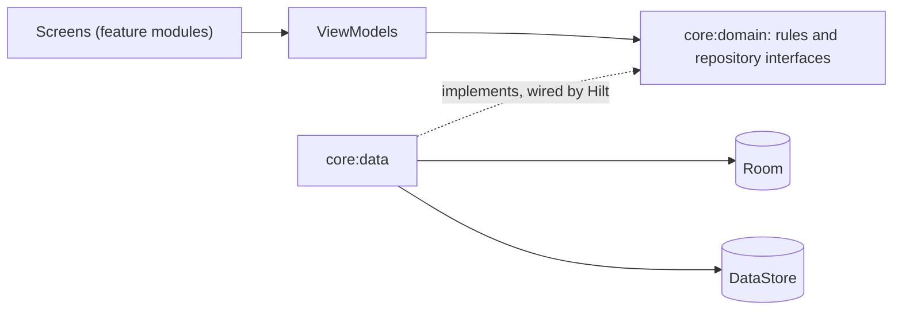

# Berylux

An Android app that hands you a few challenges every day and keeps score of the ones you close.

[](https://github.com/An3DCu/Berylux/actions/workflows/ci.yml)
[](LICENSE)


## Overview

Habit apps tend to be either a plain checklist or a pile of streak pressure. Berylux sits in between: every day it offers one daily case, one bonus case and four picks from categories like Body, Mind and People. You take on up to five, close the ones you finish, and earn Lux. Lux moves you up six gem ranks, from goshenite to red beryl.

It works fully offline. Signing in will be optional and syncs with my own server ([roadmap](#roadmap)).

This is a work in progress. Version 0.2 is the whole game, played offline as a guest, on plain Material 3. The noir case-file look comes in v0.3.

## Features in v0.2

- **Start:** pick a name and a generated sigil. No account.
- **Today:** the daily case, a bonus case and four picks, your rank and Lux, and how many of the day's 5 slots are used.
- **Cases:** close a case for its Lux, or drop it for 5 Lux. Both ask first. A case still open when the day ends at 4 AM goes cold. Earlier days are listed below today's.
- **Catalog:** 56 challenges in 7 categories, filtered by difficulty ([`challenges.json`](core/database/src/main/assets/seed/challenges.json)). Write your own in My cases, and change or delete them. Your own give no Lux, but they count for the streak.
- **Progress:** six gem ranks from goshenite to red beryl, the streak with earned freezes, and 17 achievements that unlock as you play.
- **Rivals:** a weekly board against five bots, each with its own habit. They're marked as bots. Their Lux comes from a seed, and the board is the same on every launch.
- **Tests:** 197 tests on the JVM, an instrumented test of the main flow, and CI on every pull request.

## Tech stack

| Layer | Tools |
|---|---|
| Language | Kotlin 2.4, Java 17 bytecode |
| UI | Jetpack Compose, Material 3 |
| Architecture | MVVM, one-way data flow, 18 Gradle modules with convention plugins |
| Dependency injection | Hilt |
| Data | Room, DataStore |
| Navigation | Navigation 3 |
| Testing | JUnit 4, Truth, Turbine, Robolectric, Compose UI tests |
| Quality and CI | detekt, Android Lint, GitHub Actions |

## Architecture

Screens talk to ViewModels, ViewModels use the rules and the repositories in `core:domain`, and `core:data` answers those repositories with Room and DataStore. Hilt connects `core:data` to the interfaces. Only the `app` module sees `core:data`, and features never depend on each other.

Each ViewModel shows one `UiState`, with a loading and an error state, and sends one-off messages separately. Open dialogs, filters and half-written forms sit in `SavedStateHandle`. They come back after Android stops the app in the background.



```text
app/               the app shell: tabs, Navigation 3, Hilt entry point
build-logic/       convention plugins shared by every module
core/
  model/           plain Kotlin models
  domain/          the rules and the repository interfaces, no Android code
  data/            repositories on top of Room and DataStore
  database/        Room tables, DAOs, the seed and the exported schema
  datastore/       settings
  navigation/      route keys, back stacks, the navigator
  designsystem/    theme (v0.3)
  ui/              shared screen pieces
  testing/         fakes for every repository
feature/           today, tracker, catalog, editor, progress, rivals, profile, settings
```

### Data model

Five tables: `profiles`, `categories`, `challenges`, `cases` and `achievement_unlocks`. A case links a profile to a challenge and records its status (open, closed, cold or dropped), when it was accepted and closed, on which game day, and the Lux it earned. Deleting one of your own challenges deletes its cases with it. Streaks are counted from the days with a closed case. There's no separate streak table to keep in sync.

The challenges are written to the database inside Room's own create step, before the first query can run ([`Seed.kt`](core/database/src/main/kotlin/com/anadcurukovic/berylux/core/database/seed/Seed.kt)). The schema is exported to [`core/database/schemas`](core/database/schemas). Version 2 changed a foreign key and added My cases; a test runs the migration from version 1 ([`Migrations.kt`](core/database/src/main/kotlin/com/anadcurukovic/berylux/core/database/Migrations.kt)).

## Getting started

### Prerequisites

- Android Studio 2026.2 or newer, with the Android SDK it installs (platform 37).
- Nothing else. Builds run on JDK 21, which Gradle downloads the first time.

### Setup

```powershell
git clone https://github.com/An3DCu/Berylux.git
cd Berylux
```

Open the folder in Android Studio and run it from there. Studio brings its own JDK and writes `local.properties` with the path to your Android SDK.

To use the commands below from a terminal instead, first tell Gradle where Studio's JDK and the SDK are:

```powershell
$env:JAVA_HOME = "C:\Program Files\Android\Android Studio\jbr"
$env:ANDROID_HOME = "$env:LOCALAPPDATA\Android\Sdk"
```

On macOS these are usually `/Applications/Android Studio.app/Contents/jbr/Contents/Home` and `~/Library/Android/sdk`.

### Run

Start an emulator or connect a phone with Android 8 or newer, then:

```powershell
.\gradlew.bat installDebug
```

### Tests

```powershell
.\gradlew.bat test
```

The same checks as CI:

```powershell
.\gradlew.bat assembleDebug detekt :app:lintDebug test
```

The main flow on a running emulator or phone. It clears the app's data first, and uninstalls the app when it's done:

```powershell
.\gradlew.bat connectedDebugAndroidTest
```

On macOS and Linux, use `./gradlew` instead of `.\gradlew.bat`.

## Key engineering decisions

| Decision | Why | Trade-off |
|---|---|---|
| The rules live in a plain Kotlin module | They're tested on the JVM in milliseconds, down to the night the clocks change | Models are mapped at the edges |
| Repository interfaces sit in `core:domain`, not `core:data` | Features and rules never see how data is stored | One more mapping layer |
| My own seeded random generator (SplitMix64) for the daily pick | Kotlin's seeded `Random` doesn't promise the same numbers across versions; the pick has to match on every device and later the server | A few lines to own and test |
| The seed goes in during Room's create step | The first screen can never find an empty database | The seed file is read on first launch |
| Navigation 3 with one back stack per tab | Each tab keeps its place, and Back always leaves the app through Today | More state to hold than one stack |
| The clock is an interface that tests replace | The app tests move the clock past 4 AM and check that open cases go cold and the streak moves on | Code asks the clock for the time instead of calling `Instant.now()` |
| Rival bots play from a seed, not from a server | The board looks alive offline and never changes between launches | Bots don't react to you; an online board comes in v0.5 |
| An achievement, once unlocked, stays | Dropping a case or deleting a challenge never takes a badge back | The badge list can show more than the current record would earn |

## Limitations

- Plain Material 3 for now. The case-file look comes in v0.3.
- Profile and Settings are placeholders. Changing your name and sigil, the day's start hour and the theme come in v0.3.
- One guest profile per phone, and nothing leaves it. A backup or sync comes with accounts in v0.5.
- No reminders yet: the app only knows about a day when you open it.
- No APK to download yet.
- On Android 8 in light mode, the status bar icons are dark on the dark app. The theme in v0.3 fixes it.
- Release builds aren't shrunk with R8 yet.

## Roadmap

- [x] v0.1 Foundation: rules, database, navigation, CI
- [x] v0.2 Core loop: the whole game offline as a guest
- [ ] v0.3 Character: the case-file and netrunner look, generated gems, the neon streak sign
- [ ] v0.4 Device: reminders, a home screen widget, history and stats
- [ ] v0.5 Cloud: optional accounts, sync and an online leaderboard, with my own API
- [ ] v1.0 Publish: a signed APK, hardened and documented

## Credits and license

- Started as a university project at IBU (International Burch University), rebuilt from scratch afterwards.
- The challenges were written for this app.
- Libraries are used under their own licenses, mostly Apache 2.0.
- License: Apache 2.0. See [LICENSE](LICENSE) and [NOTICE](NOTICE).

## Contact

Anad Čuruković · [an3dcu.github.io](https://an3dcu.github.io) · [LinkedIn](https://linkedin.com/in/anadcurukovic) · ancur26@proton.me
