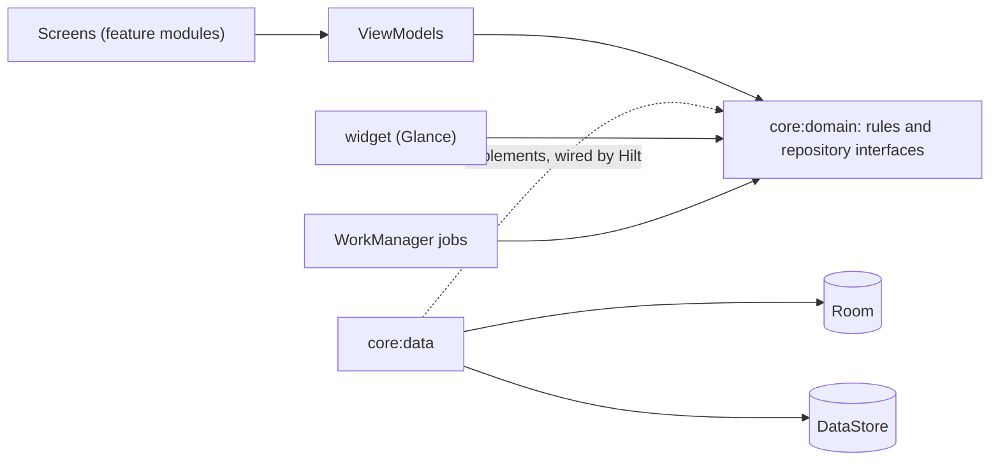

# Architecture

How Berylux is put together: the layers, the modules, the state on each screen, what runs outside the app's screens, and the data model. The [README](../README.md) has the short version.

## Layers

Screens talk to ViewModels, ViewModels use the rules and the repositories in `core:domain`, and `core:data` answers those repositories with Room and DataStore. Hilt connects `core:data` to the interfaces. Only the `app` module sees `core:data`, and features never depend on each other.



## Modules

```text
app/               the app shell: tabs, Navigation 3, Hilt entry point, the morning docket
build-logic/       convention plugins shared by every module
core/
  model/           plain Kotlin models
  domain/          the rules and the repository interfaces, no Android code
  data/            repositories on top of Room and DataStore
  database/        Room tables, DAOs, the seed and the exported schema
  datastore/       settings
  navigation/      route keys, back stacks, the navigator, the links into the app
  designsystem/    colors, type, shapes, and the drawn gems, sign, stamp and grain
  ui/              shared screen pieces
  testing/         fakes for every repository
feature/           today, tracker, catalog, editor, progress, rivals, profile, settings
widget/            the two home screen widgets, drawn with Glance
```

## State on each screen

Each ViewModel shows one `UiState`, with a loading and an error state, and sends one-off messages separately. Open dialogs, filters and half-written forms sit in `SavedStateHandle`. They come back after Android stops the app in the background.

## Outside the app's screens

- **The morning docket.** A WorkManager job sends the reminder and books the next one behind itself. There's no exact alarm: Android may send it a few minutes late to save battery. Tapping it opens Today.
- **The widgets.** Glance draws them from one flow in `core:domain`, collected while a widget's session is open. They redraw when a case changes while the app runs, and a WorkManager job redraws them when the game day ends. The sign and the CLOSED stamp are drawn as pictures in Bebas Neue, since Glance can't use the app's fonts as text.
- **The links in.** The docket, the widgets and the launcher's shortcuts open the app with an action from `AppLinks`. Close on a widget opens Cases with the app's own "Close it?".

## Data model

Five tables: `profiles`, `categories`, `challenges`, `cases` and `achievement_unlocks`. A case links a profile to a challenge and records its status (open, closed, cold or dropped), when it was accepted and closed, on which game day, and the Lux it earned. Deleting one of your own challenges deletes its cases with it. Streaks are counted from the days with a closed case. There's no separate streak table to keep in sync.

The challenges are written to the database inside Room's own create step, before the first query can run ([`Seed.kt`](../core/database/src/main/kotlin/com/anadcurukovic/berylux/core/database/seed/Seed.kt)). The schema is exported to [`core/database/schemas`](../core/database/schemas). Version 2 changed a foreign key and added My cases. Version 3 gave the sigil a seed of its own. Tests run both migrations ([`Migrations.kt`](../core/database/src/main/kotlin/com/anadcurukovic/berylux/core/database/Migrations.kt)).

Settings live in DataStore: the hour the day starts (and a new one waiting for the next day), the theme, the grain, motion, the morning docket's time, whether it's on and whether its offer was answered, and when Progress was last looked at, for the mark on new commendations.
